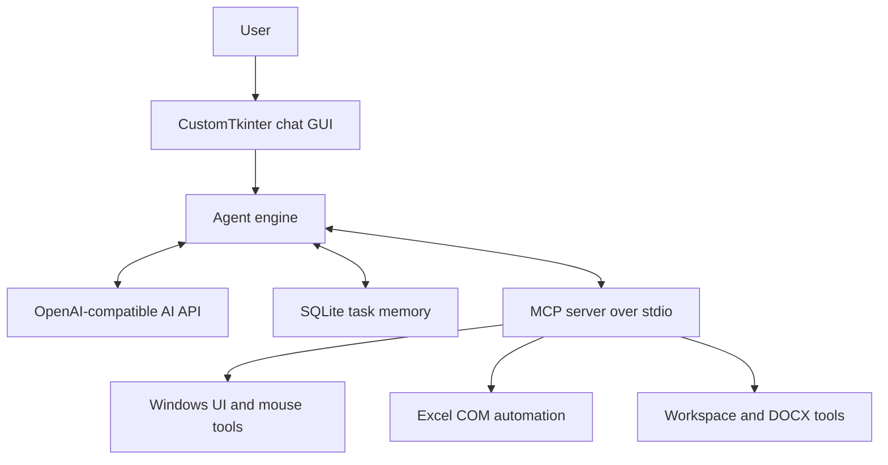

# KingMCP — Desktop AI Agent


A Python-powered Windows desktop automation assistant that combines AI vision, native function calling, the Model Context Protocol (MCP), and persistent memory. Describe a task in natural language and let the agent inspect the desktop, plan actions, execute tools, and evaluate results.

> **Development status:** v5.3 is an experimental development release. Windows integration and live AI behavior require further testing. Keep manual approval enabled for important tasks.

## Features

- AI desktop control using screenshots, mouse, keyboard, and Windows UI Automation.
- Mouse recording, looping playback, pause/resume, and JSON recording files.
- MCP tools for applications, drawing, Excel, Word, and workspace files.
- Task planning, bounded error recovery, and AI-assisted verification.
- Persistent SQLite conversation history and reusable task instructions.
- Configurable API request pacing, timeout recovery, and live agent status.
- OpenAI-compatible API configuration and native tool-calling connection test.
- Optional Windows DPAPI protection for saved API credentials.
- Manual action approval and emergency stop hotkey.

- Modern dark-mode chat interface, sidebar navigation and collapsible action log.
- Push-to-talk voice instructions and optional spoken task status.
- Named provider profiles, model discovery and per-profile settings.
- Windows executable and installer build scripts.

## Architecture



## Requirements

- Windows 10 or 11 (recommended target platforms).
- Python 3.10 or newer; a compatible Python environment is required.
- An OpenAI-compatible API provider and a model supporting vision and native tool calls.
- Microsoft Excel installed for Excel COM operations. Word document generation uses `python-docx` and does not require Microsoft Word.
- An interactive, unlocked desktop for GUI automation.

## Installation

Download or clone this repository, then open Command Prompt in the project directory. If using the incremental release archives, apply the earlier patches through v5.3 in order; the v5.3 patch alone is not a complete application.

```bat
git clone https://github.com/waynadah/KingMCP.git
cd KingMCP
py -m venv .venv
.venv\Scripts\activate
python -m pip install --upgrade pip
python -m pip install -r requirements.txt
python main.py
```

## API configuration

Open the **API Settings** tab and configure your provider:

| Setting | Example |
| --- | --- |
| Base URL | `https://ai-api.orangevpn.com.ph/v1` |
| API key | Your own provider key |
| Model ID | `anthropic/claude-haiku-5.5` |
| Requests per minute | `8` |
| Timeout | `90` seconds |

Save your settings and select **Test API and native tool calling**. The example provider and model are not guaranteed to remain available. Never commit an API key to GitHub.

### Provider profiles (v5.3)

| Provider | OpenAI-compatible base URL |
| --- | --- |
| OrangeVPN | `https://ai-api.orangevpn.com.ph/v1` |
| OpenAI | `https://api.openai.com/v1` |
| OpenRouter | `https://openrouter.ai/api/v1` |
| DeepSeek | `https://api.deepseek.com/v1` |
| Custom | Your compatible HTTPS endpoint |

Enter your own key, click **Discover models**, choose or type a model ID, and test native tool calling. Save a named profile, then use **Save Settings** to persist the active configuration. Model discovery retrieves the first page only. A successful tool-calling test does not establish vision support; not every model or provider is suitable for desktop automation. Native non-OpenAI API formats are not supported. Rate-limit accounting is shared across providers and excludes discovery and connection tests.

## Usage

1. Open the **AI Agent** tab.
2. Enter a task in natural language.
3. Set the maximum number of steps and keep **Approve each action** enabled.
4. Click **Send task** and review proposed actions.
5. Monitor the action log. Use **Continue Task** to resume with previous context, or **Reset All Tasks** to clear task memory, workflows, and logs.

Example tasks:

```text
Open Calculator and calculate 250 multiplied by 15.
Open Paint and draw a simple house.
Create a professional application letter and save it as application.docx.
Create an Excel expense table with a SUM formula.
Find PHP files in my approved workspace.
```

### Keyboard shortcuts

| Key | Action |
| --- | --- |
| F6 | Start recording |
| F7 | Stop recording |
| F8 | Loop playback |
| F9 | Pause / resume |
| F10 | Stop playback or AI task |
| F12 | Exit |

Stopping does not undo completed actions, and an in-progress tool may need to finish before stopping.

## Voice control

Click **Speak task**, choose `en-US`, `en-PH` or `fil-PH`, and approve online transcription. Review the recognized text before submitting. Enable **Speak task status** for local Windows speech output (off by default). SpeechRecognition uses Google's online recognition service; microphone audio is transmitted for transcription after confirmation. Windows SAPI reads the final status, not every response. F10 stops automation, not ongoing transcription.

## MCP tools

| Category | Tools |
| --- | --- |
| Screen | `screenshot`, `screen_size` |
| Mouse and keyboard | `click`, `move`, `draw_path`, `type_text`, `hotkey`, `press`, `scroll` |
| Windows | `list_windows`, `focus_window`, `open_application`, `inspect_window`, `click_control` |
| Excel | `excel_write`, `excel_read`, `excel_format`, `excel_add_sheet`, `excel_formula`, `excel_save_copy` |
| Browser | `browser_open` |
| Files | `file_list`, `file_read`, `file_write`, `file_search` |
| Documents | `word_create`, `word_append` |

Browser support currently opens URLs in the default browser; further interaction relies on existing desktop tools. It is not a Playwright integration.

## Workspace

The default workspace for file and document tools is:

```text
%USERPROFILE%\DesktopAIWorkspace
```

To choose another workspace, run these commands before launching:

```bat
set "DESKTOPAI_WORKSPACE=C:\Projects\MyProject"
python main.py
```

File tools restrict paths to the workspace and require explicit overwrite intent for existing files. The workspace is not an operating-system sandbox: mouse and keyboard tools can interact with other accessible applications.

## Memory and workflows

Task history is stored locally in `%LOCALAPPDATA%\DesktopAI\memory.db`. The agent retains up to 100 recent history entries and sends bounded relevant context to the AI provider. Legacy JSON task history is imported automatically.

Use the **Workflows** tab to save the last successful task under a name and load it again. Workflows reuse instructions with fresh AI analysis, rather than replaying an exact tool sequence. Reset All Tasks clears task history and saved workflows, but preserves API settings and recordings.

## Project structure

```text
KingMCP/
├── main.py                 # GUI, recorder, API settings
├── agent_engine.py         # AI loop, planning, retries
├── desktop_server.py       # MCP desktop tools
├── application_tools.py    # File, browser, Word and Excel tools
├── task_memory.py          # SQLite history and workflows
├── voice_tools.py          # Speech recognition and Windows speech
├── build_windows.cmd       # PyInstaller build script
├── DesktopAI.iss           # Inno Setup installer configuration
├── desktopai.ico           # Application icon
├── .gitignore              # Local and generated file exclusions
├── requirements.txt        # Python dependencies
└── README.md
```

## Build a Windows executable

Run these commands from the repository in an activated Python environment:

```bat
python -m pip install -r requirements.txt
python -m pip install "mcp[cli]"
build_windows.cmd
```

The extra MCP CLI dependencies prevent the known `ModuleNotFoundError: No module named 'typer'` error when PyInstaller collects MCP submodules. For a permanent fix, change the MCP requirement to `mcp[cli]>=1.12,<2` if it has not already been updated.

After a successful build, launch `dist\DesktopAI\DesktopAI.exe`. Keep the complete folder, including `_internal` and `server`, together. The MCP server is packaged separately for stdio communication.

To create an installer, install [Inno Setup](https://jrsoftware.org/isinfo.php), open `DesktopAI.iss`, and compile it. Publish tested binaries via [GitHub Releases](https://github.com/waynadah/KingMCP/releases), not the source tree. The executable is unsigned and may trigger SmartScreen. Build scripts are provided; successful Windows compilation is not guaranteed.

## Troubleshooting

| Problem | Suggested action |
| --- | --- |
| HTTP 429 / rate limit | Reduce RPM to 6–8, wait for cooldown, check shared quota. |
| API timeout | Increase timeout in settings and check provider connectivity. |
| Native tool calling fails | Select a model supporting function calling and run the API test. |
| UI control not found | Inspect the correct window; use screenshot-based interaction if necessary. |
| Excel tool fails | Open Excel and a workbook; verify COM access and pywin32 installation. |
| PyInstaller missing `typer` | Run `python -m pip install "mcp[cli]"` in the build environment. |
| Microphone unavailable | Check Windows microphone permissions and PyAudio installation. |
| Missing dependency | Activate the virtual environment and reinstall requirements. |
| Agent repeats checks | Stop the task, inspect the actual result, and continue with a specific instruction. |

## Privacy and safety

This application can control your desktop. Only run trusted tasks, review actions, and keep F10 available. Screenshots, prompts, retrieved file contents, and tool results may be transmitted to the configured AI provider. Local task history is not encrypted. Provider profiles are stored in `%LOCALAPPDATA%\DesktopAI\providers.json`; remembered keys use Windows DPAPI. Task memory is shared across providers, so reset it before switching if necessary. Avoid exposing confidential information, and do not treat model verification as proof of correctness. Use a dedicated test workspace for development.

Before publishing, exclude `.venv/`, `__pycache__/`, `.env`, `*.dpapi`, `api_settings.json`, `providers.json`, `memory.db*`, `task_history.json`, private recordings, and screenshots containing sensitive data from Git. Review your entire commit history for secrets.

## Roadmap

| Version | Milestone | Status |
| --- | --- | --- |
| 4.0 | MCP foundation | Implemented |
| 4.1 | Rate-limit recovery | Implemented |
| 4.2 | Live status | Implemented |
| 4.3 | Timeout recovery and drawing | Implemented |
| 4.4 | Persistent memory | Implemented |
| 4.5 | Windows UI Automation | Implemented |
| 4.6 | Planning and self-correction | Implemented |
| 4.7 | SQLite memory and workflows | Implemented |
| 4.8 | Advanced application tools | Implemented |
| 4.9 | API optimization | Implemented |
| 5.0 | Modern chat-based GUI | Implemented |
| 5.1 | Voice commands | Implemented |
| 5.2 | Windows executable packaging | Build scripts provided |
| 5.3 | Multiple providers and model discovery | Implemented |
| 5.4 | Local workflow replay | Planned |
| 5.5 | Advanced task management | Planned |
| 6.0 | Multi-agent desktop assistant | Planned |

Implemented means source code is available in the development patches; it does not imply full Windows integration testing. Future improvements include richer browser automation, stronger verification and local workflow execution.

## Repository

[github.com/waynadah/KingMCP](https://github.com/waynadah/KingMCP) · [Issues](https://github.com/waynadah/KingMCP/issues) · [Releases](https://github.com/waynadah/KingMCP/releases)

## Contributing

Bug reports and suggestions are welcome. Include the application version, Python version, reproduction steps, and sanitized error logs. Do not include API keys or confidential screenshots.

## License

A license has not yet been specified. The repository owner should select a license before granting redistribution or modification rights.
